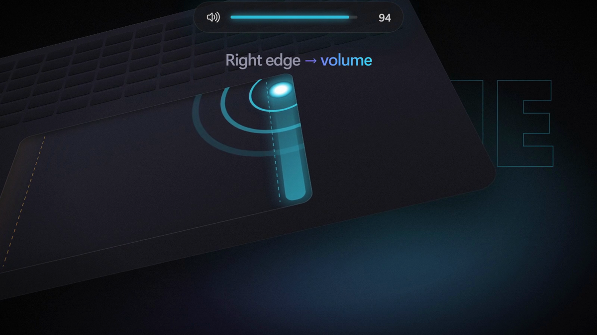

# Sway

Sway turns the edges of your laptop's touchpad into sliders. Slide one finger up or down the **right edge** to change the volume, or the **left edge** to change screen brightness. The level follows your finger, like the edge sliders on a phone. The middle of the touchpad works exactly as before.



## Download

Grab the latest version from the [Releases page](https://github.com/ayushgade06/sway/releases). There are two builds, one for each kind of laptop:

| File | Size | Use it if |
|---|---|---|
| `Sway-<version>-win-x64.zip` | 99 MB | Your laptop has an Intel or AMD processor (most laptops). |
| `Sway-<version>-win-arm64.zip` | 93 MB | Your laptop has a Snapdragon processor. |

Extract the zip anywhere and double-click **Sway.exe**. Nothing else to install, and no admin rights needed. Sway appears in the system tray.

Sway isn't code signed yet, so Windows may show "Windows protected your PC" the first time. Click **More info**, then **Run anyway**. To check that your download is exactly what the build server produced, compare its checksum with the `.sha256` file published next to it:

```powershell
Get-FileHash .\Sway-<version>-win-x64.zip -Algorithm SHA256
```

You'll need Windows 11 (Windows 10 may work but isn't tested) and a **Precision Touchpad**, which almost every laptop from 2018 onwards has. To check, open **Settings → Bluetooth & devices → Touchpad**. If it says "Your PC has a precision touchpad", you're set.

To install Sway properly (a Start menu entry, and listed in **Settings → Apps** so you can uninstall it), open a terminal in the extracted folder and run `.\Sway.exe --install`. This copies Sway to `%LOCALAPPDATA%\Programs\Sway` for your user only.

## What you get

- **Right edge:** swipe up for louder, down for quieter. Raising the volume also unmutes.
- **Left edge:** swipe up for brighter, down for dimmer.
- A small indicator at the top of the screen shows the level and fades out when you lift your finger
- One full-height swipe covers the whole 0 to 100 range
- Taps, two-finger scrolling and three- or four-finger gestures are never affected
- A swipe has to *start* inside the edge strip (about a finger wide). A stroke that starts in the middle and slides to the edge changes nothing, so normal mousing is safe.
- Settings to swap the edges, turn either edge off, change the edge width and swipe length, keep the cursor still during swipes, and start Sway when you sign in. Changes apply immediately.

Right-click the tray icon for **Enabled**, **Settings…** and **Quit**. On Windows 11, new tray icons start out hidden behind the **^** arrow. Drag Sway onto the taskbar to keep it in view.

## How it works

Sway reads a copy of your touchpad's raw finger positions through Windows' Raw Input API (`src/Sway.Core/Input/RawInputTouchSource.cs`). It can't change or block what the touchpad does. When a finger starts in an edge strip and moves vertically, Sway sets the volume through the Windows Core Audio API, and the brightness through WMI (`WmiMonitorBrightnessMethods`), the same mechanism as Windows' own brightness slider.

If you turn on **Keep the cursor still**, Sway adds a low-level mouse hook (`src/Sway.Core/Input/CursorFreezer.cs`) that drops the cursor movement from the swiping finger, and lets everything through again when you lift. If Sway stops receiving touch frames, the freeze releases itself within 250 ms. If Sway hangs or exits, Windows removes the hook automatically.

## Privacy

Sway sees every touchpad movement, so trust is the whole product:

- It makes **no network connections**. There's no update check, no analytics and no crash reporting. A CI test fails if any Sway assembly references a networking library.
- Touch data never leaves the process and is never written to disk, unless **you** run `Sway.Probe record`.
- The only things it stores are your settings in `%APPDATA%\Sway\settings.json` and a small log (no touch coordinates) in `%LOCALAPPDATA%\Sway\log.txt`.

Some antivirus products dislike apps that read raw input and use a mouse hook. If yours flags Sway, please open an issue.

## Uninstall

- If you used `--install`: **Settings → Apps → Installed apps → Sway → Uninstall**. Sway asks whether to delete your settings too.
- If you just ran the zip: choose **Quit** from the tray menu and delete the folder. If you turned on "start when I sign in", turn it off in Settings first. Settings are in `%APPDATA%\Sway`.

## Build it yourself

You'll need the .NET 10 SDK. The tests don't need a touchpad.

```powershell
git clone https://github.com/ayushgade06/sway
cd sway
dotnet run --project src/Sway
dotnet test
```

To make your own zip:

```powershell
./eng/publish.ps1 -Arch x64
```

[CONTRIBUTING.md](CONTRIBUTING.md) covers how to help, and the design docs are in [docs/](docs).

## Good to know

- Sway is a **pre-alpha**. It's been tested on one laptop so far. Every hardware report helps, whether Sway works for you or not: run `.\Sway.Probe.exe report` (it contains no personal data) and paste the output into a **Hardware report** issue. `Sway.Probe.exe live` shows your fingers on a map of the touchpad, and `gestures` shows what Sway detects. See [docs/HARDWARE.md](docs/HARDWARE.md).
- Brightness works for the **built-in screen** only, not external monitors. It may also be unavailable in some discrete-GPU (MUX) display modes; the brightness edge then turns off and the tray icon says so.
- Adaptive or content-adaptive brightness can override changes you make.
- Exclusive full-screen games cover the indicator. The level still changes.

MIT License. Third-party notices are in [THIRD_PARTY_NOTICES.md](THIRD_PARTY_NOTICES.md).
